# Кастинг ЗИЛАРТа: как выглядят Зиля и Тюфель, как звучат герои

## Раунд 2: сцены квеста в стилях 1 и 4 (26.11, A-65)

Сделано по вашему указанию от 26.11, 23:24. Потрачено **≈ $2,32 из $5** (+ $1,05 на правку пропорций 27.11, итого ≈ $3,37), по строкам — в `state/MEDIA_SPEND.md`. Каждый кадр я просмотрел на брак: лишние лапы и хвосты, крыло, похожее на руку, буквы в кадре. Забракованное здесь не показано, список — в конце раздела.

### Тюфель 1 стал барином

| Было (раунд 1) | Стало |
|---|---|
| 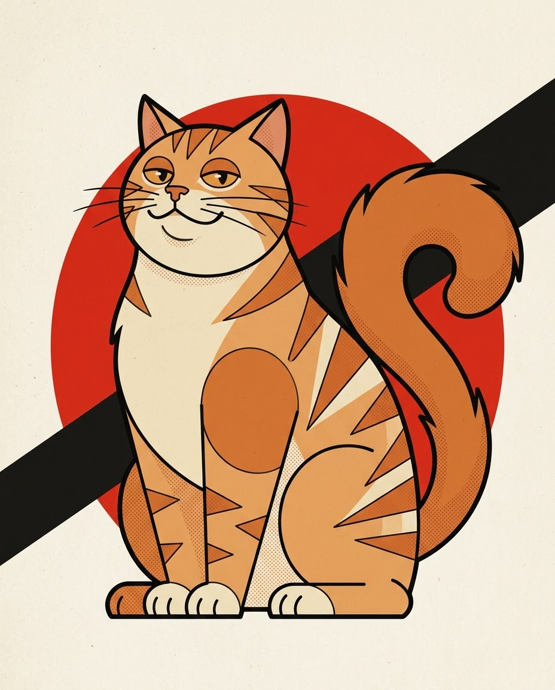 | 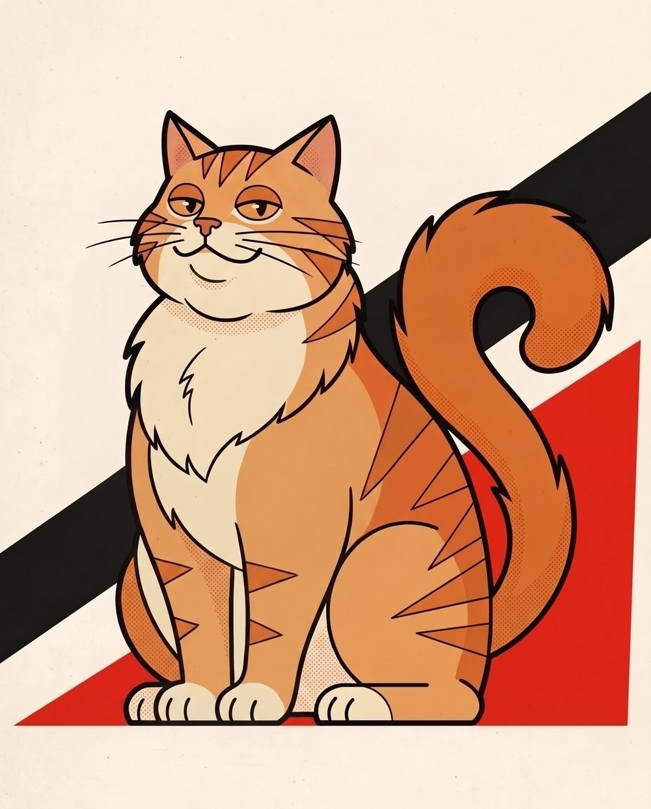 |

Лицо, полоски и хвост-вопрос остались прежними: кадр сделан правкой старого (`/edit`), а не нарисован заново. Тюфель стал тяжелее и шире, у него пышная грудь, двойной подбородок и поднятый нос, на зрителя он смотрит сверху вниз. Красный круг на фоне заменён клином (см. «Зиля и флаг Японии» ниже).

### Три сцены из сценария: стиль 1 (плакат) и стиль 4 (гуашь)

Обе версии сцены сделаны по одному и тому же описанию, отличается только стиль. Модель каждый раз строит кадр сама, поэтому композиции похожи, но не совпадают до пикселя. Герои взяты с листов кастинга, в стиле 1 Тюфель уже «барский».

| Сцена | Стиль 1 — плакат | Стиль 4 — гуашь |
|---|---|---|
| **Встреча** (гл. 3, скамейка): «Тюфель. Не „кис-кис“…» | 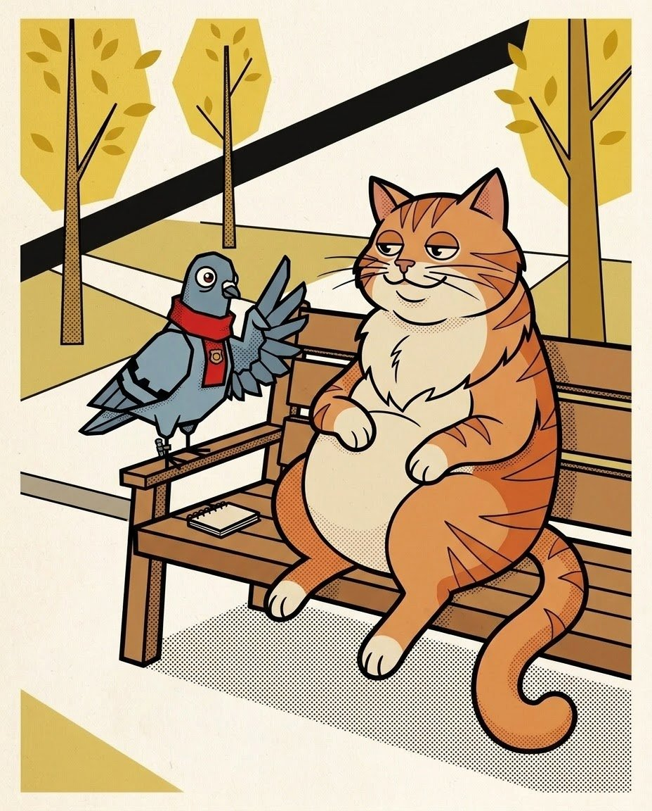 | 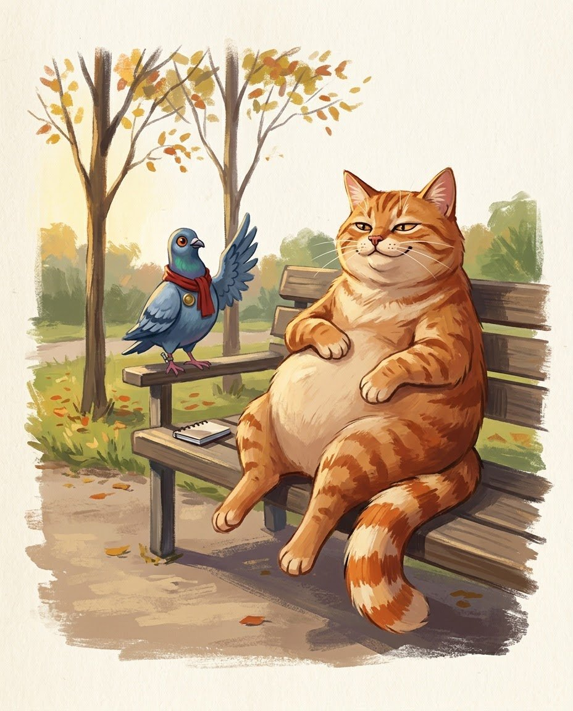 |
| **Мокрая лапа** (гл. 10): кот проявляет оборот письма | 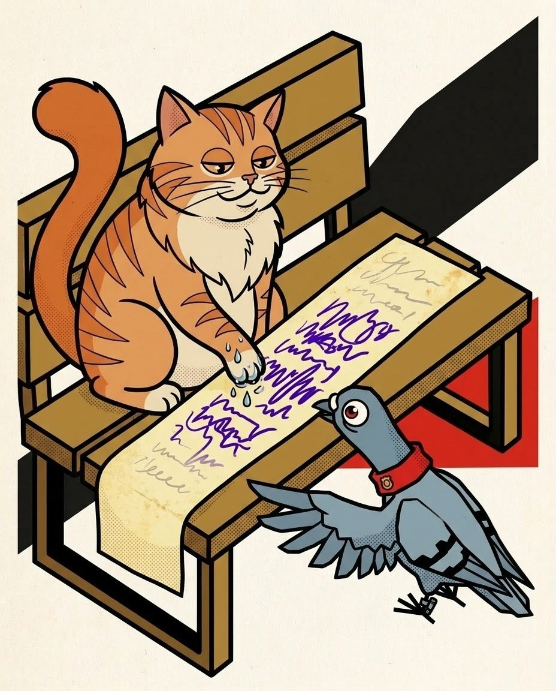 | 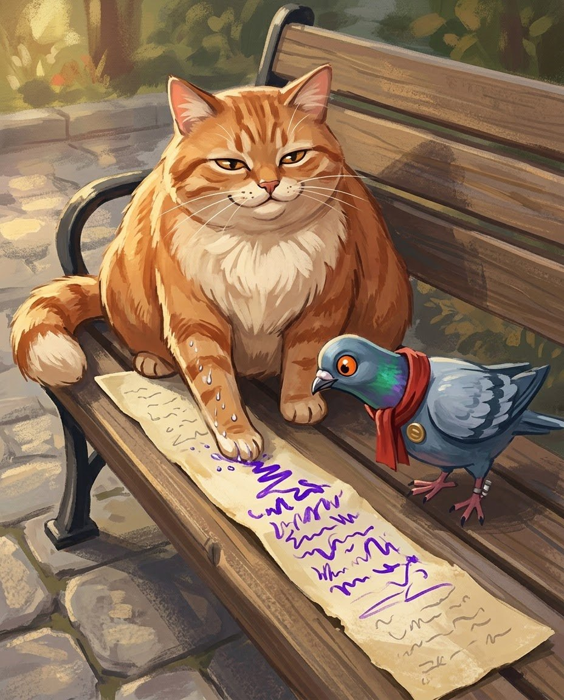 |
| **Подвезти до метро?** (эпилог): «Зиля несёт Тюфеля над крышами» | 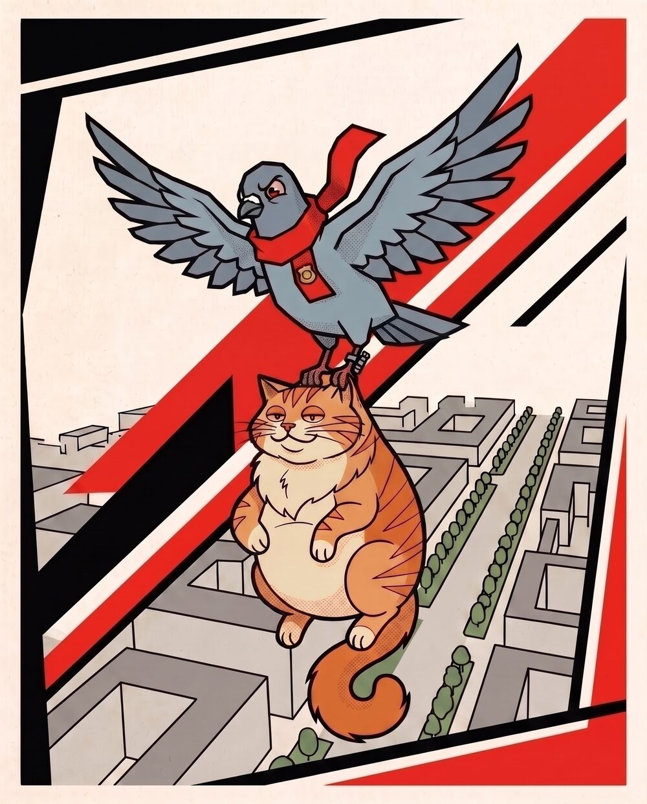 | 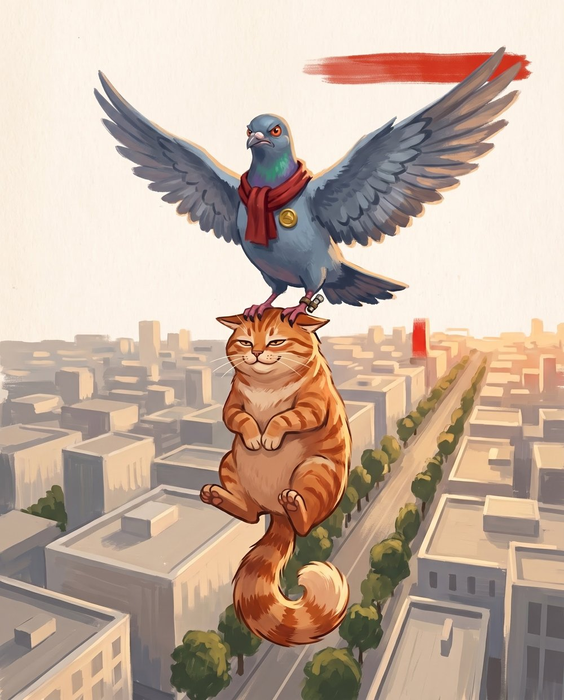 |
| **27.11: пропорции исправлены по замечанию владельца** | «Встреча» и «Полёт» перерисованы (`/edit`, pro, 2K) | см. ниже |

**Пропорции (ваше замечание 27.11).** Теперь у героев есть канон: Зиля = 0,6–0,7 длины Тюфеля, голова Зили ≈ 0,8–0,9 головы кота, кот всегда больше и тяжелее, в том числе в полёте (`../specs/02-casting.md`). Что сделано:
- **Встреча.** Голубь на подлокотнике стал примерно вдвое крупнее, глаз на уровне рта кота; в плакате заодно поправлено поднятое крыло, теперь это перья, а не «пальцы».
- **Полёт.** Кот стал крупнее и толще голубя, туловище Зили заметно меньше кота. В гуаши получилось чисто. Плакат упрямее: после трёх правок кот шире голубя примерно в полтора раза, но с хвостом Зиля по длине всё ещё близок к коту. Это граница канона. В финальной версии выбранного стиля сцену лучше нарисовать заново с каноном в промпте, а не править старую.
- **Мокрая лапа** проверена: голубь там ≈ 0,6–0,7 длины кота, «младенца» нет. Не перерисовывали.
- **Анимации** `round2-scene-fly-1.mp4` и `-4.mp4` сделаны со старых пропорций. Переделаем после выбора стиля (A-66), чтобы не платить за ролик дважды.

Что видно в сценах:
- **Встреча.** В обоих стилях кот развалился на скамейке, как барин на диване, а Зиля допрашивает его с подлокотника. В гуаши кот получился самым обаятельным за оба раунда. В плакате Зиля поднял крыло веером, как на листе кастинга: это перья, а не пальцы, но в финале веер стоит сделать уже.
- **Мокрая лапа.** На полоске бумаги лиловые каракули, букв и спойлеров нет. В стиле 1 бледные строки по краям похожи на почерк, но не читаются. В гуаши кот ближе к своему листу кастинга.
- **Полёт.** Это самая сильная сцена в обоих стилях. Зиля держит кота лапами за макушку, кот висит с довольной мордой. По обоим кадрам сделана финальная версия 2K на дорогой модели. Брови у Зили сведены, он скорее упрямый, чем злой. Если нужен «гордый», это правится через `/edit`. Пергола и реальные дома не нарисованы: для них нужен фото-референс (правило от 24.11), поэтому город условный.

### Анимация: по одной на стиль, 5 секунд, без звука

| Стиль 1 | Стиль 4 |
|---|---|
| [round2-scene-fly-1.mp4](round2-scene-fly-1.mp4) (1,3 МБ) | [round2-scene-fly-4.mp4](round2-scene-fly-4.mp4) (0,95 МБ) |

Обе анимации сделаны от сцены «Полёт» на Kling 2.5 turbo pro ($0,35 за ролик). Эта модель уже оживляла Зилю, и на ней ничего не плывёт. Hailuo-02 дешевле на $0,08, но на наших героях её не проверяли. В ролике Зиля машет крыльями, шарф развевается, кот моргает и качает хвостом, город уходит назад. Брака в покадровой проверке нет. В стиле 4 задние лапы кота к концу ролика частично скрываются за телом, на телефоне это почти не заметно. Плоский плакат анимируется чище, гуашь «дышит» мазками.

### Зиля и «флаг Японии»

Вашу фразу «как будто голубь на фоне флага Японии» я понял как замечание: в раунде 1 у Зили 1 и Зили 4 за спиной красный круг. Поэтому сделаны три фона без круга, герой не менялся:

| Стиль 1: красный клин | Стиль 1: красная плоскость | Стиль 4: мазок |
|---|---|---|
| 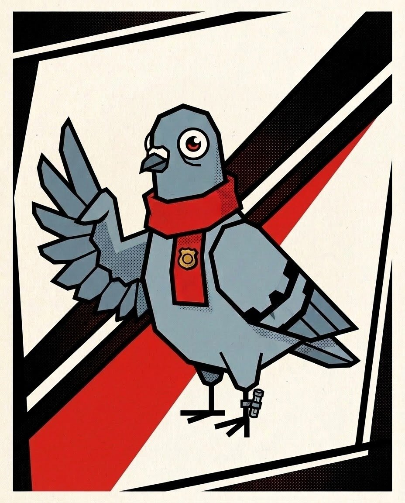 | 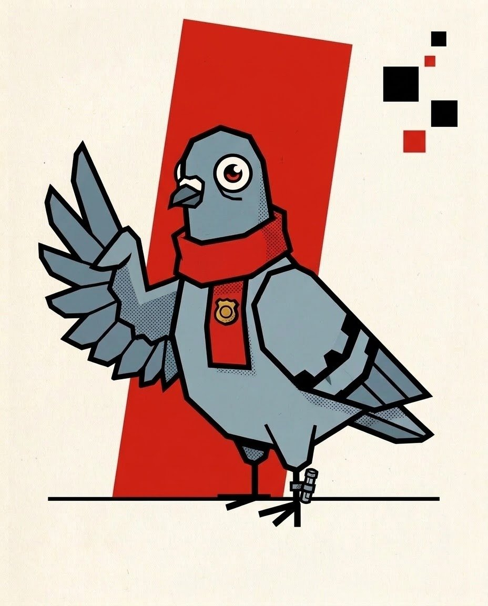 | 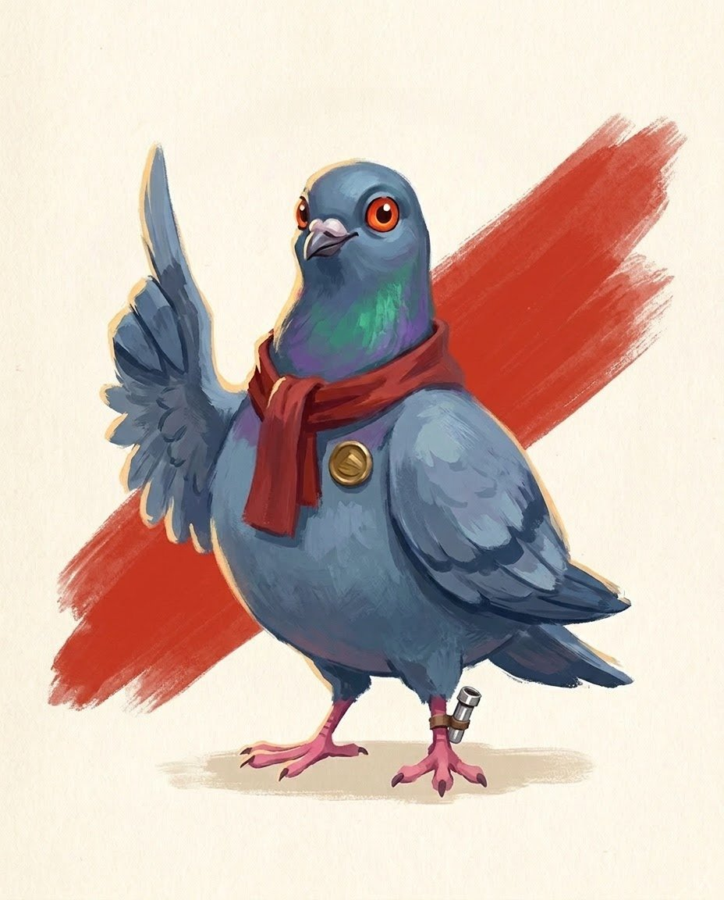 |

Если вы, наоборот, хотели круг, Зиля на круге уже есть: [zilya-1-poster.jpg](zilya-1-poster.jpg) и [zilya-4-gouache.jpg](zilya-4-gouache.jpg). Плоскость (средний кадр) читается лучше всех и меньше всего похожа на флаг. Клин динамичнее, но рамка и полосы перегружают маленький экран. Поднятое крыло у Зили 1 и Зили 4 осталось с раунда 1: у плаката это веер перьев, у гуаши кончик похож на большой палец. В финальном листе героя это поправим.

### Голоса: новые пробы

Тексты взяты дословно из текущего сценария 5.3. В нём реплика Лёвы уже начинается со «Смотрю», а не с «Гляжу», поэтому «гляжу» в озвучке больше нет. Ударения и интонация размечены по новому правилу (раздел ниже). Все записи прослушаны распознаванием речи, слова на месте, если в таблице не сказано иное.

**Тюфель** (гл. 3): «Мр-р-да. Кино. Послушайте лучше, что сказывала бабушка. В ту осень завод только и говорил, что о ленте.»

| Вариант | Файл | Как сделан | Что слышно по проверке |
|---|---|---|---|
| D | [tyufel-d-eric.mp3](voices/tyufel-d-eric.mp3) | ElevenLabs, голос Eric, теги `[purring, contentedly]`, `[lazily, amused]`, `[cosy, slightly purring]` | «Мр-р-да» вышло раскатистым «Ррр, да», все слова верны, 8,9 с |
| E | [tyufel-e-design.mp3](voices/tyufel-e-design.mp3) | **голос по описанию** (Qwen3 Voice Design): «пухлый добродушный домовитый кот из старого мультфильма, мягкий тёплый голос с мурлыкающим рокотом и раскатистым „р“, неторопливый, довольный, чуть барский» | тембр задан описанием, а не выбран из готовых. Распознавание записало «Мр-р-да» как «Морда»: послушайте, как это звучит. 9,4 с |
| F | [tyufel-f-minimax.mp3](voices/tyufel-f-minimax.mp3) | MiniMax, голос Elegant_Man, эмоция «довольный», мягче и медленнее | «Мр-да. Кино?» — «Кино» прозвучало с вопросом, остальное верно, 10,1 с |

Голоса конкретного актёра ни в одном варианте нет: характер (мурлычущий, хозяйственный, вальяжный) задан словами. Вариант E на fal нельзя закрепить за героем как готовый голос. Если он понравится, его нужно будет клонировать из этого дубля (отдельный шаг с одобрением) или заново подобрать в ElevenLabs Voice Design (см. ниже).

**Лёва** (гл. 4): «Смотрю на ваших свидетелей. Оба честные, но пуска ни один из них не видел. Я-то видел: стоял на стремянке с кистью.»

| Вариант | Файл | Голос и интонация | Длительность |
|---|---|---|---|
| C | [lyova-c-george.mp3](voices/lyova-c-george.mp3) | George (как в раунде 1), но по фразам: оценивает → чуть свысока → гордо «Я-то видел» | 9,3 с |
| D | [lyova-d-daniel.mp3](voices/lyova-d-daniel.mp3) | Daniel, ниже и солиднее, та же разметка | 9,0 с |

Распознавание в обоих вариантах услышало «пускай ни один» вместо «пуска ни один»: на слух эти слова сливаются. Проверьте ухом, не проглочено ли «пуска».

**Гоша** (гл. 8): «„Синяя птица“? Моя машина, сам сидел за рулём. Ей всё равно, берег под колёсами или вода: съехала в реку и поплыла.»

| Вариант | Файл | Голос и интонация | Длительность |
|---|---|---|---|
| B | [gosha-b-roger.mp3](voices/gosha-b-roger.mp3) | Roger (как в раунде 1): узнал старого друга → гордо → коротко, со смешком | 10,8 с |
| C | [gosha-c-bill.mp3](voices/gosha-c-bill.mp3) | Bill: старше и хрипловатее, та же разметка | 11,2 с |

«Берег» в обоих вариантах размечен как «бе́рег» и, по замеру, звучит с ударением на первом слоге.

### Ударения и интонация: что поменяли, чтобы ошибки не повторялись

- **Откуда «берЁг».** Модель путает «берег» с «берёг» (от «беречь»), потому что в тексте нет «ё». Ошибка случайная: тот же голос Roger в раунде 1 сказал «берЁг», а сегодня на трёх дублях подряд сказал «бЕрег».
- **Что работает (проверено сегодня).** Буква «ё» везде, где она есть. Знак ударения над гласной (`бе́рег`, `гляжу́`) на словах из списка риска: модели ElevenLabs и MiniMax его не читают вслух и не сбиваются. Для имён в запасе есть фонетическая запись (IPA). Знак «+» и заглавную букву не используем: это не документировано.
- **Проверка.** Распознавание речи ловит неверные слова, но не ударения. Ударение проверяем на слух, а для спорных слов делаем два дубля и выбираем верный. Есть и объективная подсказка: ударный гласный длиннее и с движением тона. Так подтверждены «бЕрег» в новых записях и «берЁг» в старой записи Гоши.
- **Интонация.** Раньше на всю реплику ставился один тег. Теперь тег ставится перед каждой фразой и описывает чувство и отношение: «узнал старого друга», «чуть свысока», «с тихой гордостью». Стабильность голоса снижена до 0,35, чтобы речь была живее. Перед озвучкой реплику размечаем: кому говорит, зачем и что чувствует.
- Правило целиком: `docs/fal-guide.md`, раздел «Озвучка» → «Ударения» и «Интонация»; рецепт героев — `voices.md`.

### Подключить ElevenLabs напрямую?

**Объём ЗИЛАРТа:** реплики героев — около **33 тыс. знаков** (Зиля 22,2 тыс., Тюфель 9,4 тыс., Лёва 1,0 тыс., Гоша 0,3 тыс.). С двумя-тремя дублями на реплику это ~70–100 тыс. знаков на квест.

| | Через fal (сейчас) | ElevenLabs напрямую |
|---|---|---|
| Цена | `eleven-v4` **$0,08 за 1000 знаков** (сверено в fal 26.11) → квест с дублями ≈ **$6–8** | тарифы по месяцам: Starter **$5** (~30 тыс. знаков), Creator **$22** (~100 тыс., первый месяц обычно со скидкой), Pro **$99** (~500 тыс.) → **$0,17–0,22 за 1000**, т. е. дороже fal в 2–3 раза |
| Голоса | только ~20 готовых голосов по имени (Callum, George, Roger…), почти все с английским акцентом в основе | **Библиотека голосов** (тысячи голосов от авторов, есть носители русского), **Voice Design** с сохранением голоса за героем, клонирование |
| Ударения | знак ударения в тексте, перепроверка дублями | то же + **словари произношения** (правило «берег → бе́рег» применяется ко всем репликам автоматически) и редактор Studio с перегенерацией одного слова |
| Права | по условиям fal | коммерческие права с платного тарифа (на бесплатном — нет) |

**Рекомендация.** Напрямую выйдет не дешевле, а дороже. Покупать ElevenLabs стоит не ради цены, а ради голосов: русскоязычный голос-носитель из библиотеки сам ставит ударения и интонацию лучше, чем любая разметка. Предлагаю **Starter на один месяц ($5)**: выбрать в библиотеке или в Voice Design голос для Тюфеля и свидетелей и сделать пробы. Если голос найдётся, решим, озвучивать ли весь квест там (Creator, $22 на месяц) или вернуться к fal. Зилю (Callum) можно оставить как есть. Коннектор ElevenLabs в моей сессии не виден, поэтому пробы сделает следующая итерация, если коннектор будет доступен агенту.

Цены ElevenLabs я взял из обзоров и по памяти, страницы не открывал (правило: только поиск). Перед покупкой сверьте на [elevenlabs.io/pricing](https://elevenlabs.io/pricing) и [elevenlabs.io/pricing/api](https://elevenlabs.io/pricing/api). В выдаче поиска 26.11 у ElevenLabs висит распродажа «до −55 %» до 1 декабря.

Источники: [ElevenLabs — тарифы API](https://elevenlabs.io/pricing/api); [ElevenLabs — произношение, лучшие практики](https://elevenlabs.io/docs/best-practices/prompting/pronunciation); [ElevenLabs — промпты для v3 (теги)](https://elevenlabs.io/docs/best-practices/prompting/eleven-v3); [ElevenLabs — словари произношения](https://elevenlabs.io/docs/eleven-api/guides/how-to/text-to-speech/pronunciation-dictionaries); [обзор тарифов 2026 (dev.to)](https://dev.to/techsifted/elevenlabs-pricing-2026-plans-credits-and-api-costs-explained-1549); [RUAccent — расстановка ударений в русском, COLING 2025](https://aclanthology.org/2025.coling-main.444).

### Рекомендация по раунду 2

- **Стиль 1 (плакат) с новым «барским» Тюфелем.** Он совпадает с брендом (красное, чёрное, диагонали) и читается на телефоне. Финальная сцена в нём самая эффектная, а плоский рисунок чище анимируется. Стиль 4 теплее, в сцене «Встреча» кот в нём обаятельнее всего. Если важнее уют, чем узнаваемость бренда, выбирайте 4.
- **Фон Зили — «красная плоскость»** вместо круга.
- **Голоса — послушайте, я их не слышу.** По проверке слов чище всего Тюфель D (Eric) и F (MiniMax). E (голос по описанию) ближе всего к «мурчащему» замыслу, но его сложнее закрепить за героем. Лёва C, Гоша B — прежние голоса, но теперь с разметкой по фразам.

**Ваш выбор.** Ответ: «Стиль 1, фон — плоскость, Тюфель D, Лёва C, Гоша B; ElevenLabs Starter — да / нет». Без ответа продолжим с этим вариантом, ElevenLabs без вашего «да» не подключаем.

**Отбраковано в раунде 2 (не показано):**
- «Мокрая лапа», гуашь, первый кадр: кот худой и непохожий на Тюфеля. Переделан.
- Тюфель 1, первые черновики «пообъёмнее»: стоял на задних лапах «столбиком», скорее упрашивал, чем барствовал. Взят за основу и переделан на дорогой модели.
- Голос Тюфеля по описанию, второй вариант промпта: 14,7 с вместо ~9, «что о ленте» смазалось в «в штуаленте».
- Черновики сцены «Полёт» на дешёвой модели заменены финальными версиями.

**В fal:** всё показанное лежит в коллекции «ЗИЛАРТ — кастинг героев (A-65)» (`dc3qu2sregj2mdo1pq3g`). Оригиналы картинок там в 2K, видео в полном размере (5–6 МБ, в репозитории сжатые копии).

---

## Раунд 1: четыре стиля и первые голоса (26.11, A-60)

Раунд по указанию владельца от 26.11 (A-60). Потрачено **≈ $1,69 из $5** (подробно по строкам — `state/MEDIA_SPEND.md`). Все картинки — черновики (`fal-ai/nano-banana-2`, 1K): выбираем направление, финал нарисуем дорогой моделью от выбранного черновика (`/edit`, чтобы герой не «поплыл»). Промпты — `../specs/02-casting.md`.

Все четыре стиля сделаны одинаково: формат 4:5, кремовая «бумага», один красный знак фона, без текста. Черты героя одни и те же: у Зили сизое оперение, красный шарф, значок, гильза для письма на лапе; у Тюфеля — толстый рыжий полосатый кот, хвост вопросом, полуприкрытые глаза.

### Зиля

| № | Картинка | Стиль и чем хорош для квеста |
|---|---|---|
| 1 |  | **Плакат 1920-х** — развитие прежнего портрета: та же голова и шарф, вместо лупы значок и гильза. Самый «авангардный», читается в мелком размере, уже есть видео с этим Зилей. |
| 2 | 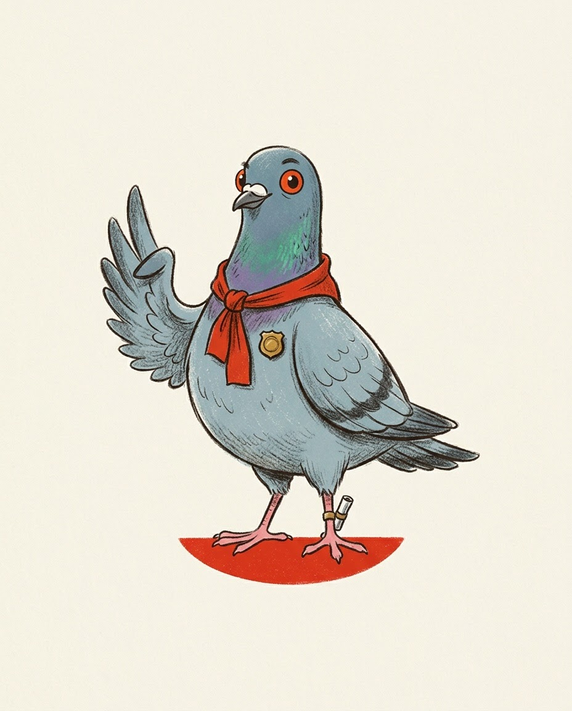 | **Тёплая книжная графика** — карандаш и литография, мягкий и добрый. Подходит семьям с детьми, но меньше связан с конструктивизмом ЗИЛа. |
| 3 |  | **Вырезка-коллаж** — герой сложен из рваной бумаги. Самый необычный и «рукотворный», хорошо ложится на тему писем и архива. |
| 4 |  | **Гуашь** — живописный, объёмный, самый «дорогой» на вид; хуже читается мелко и сложнее держать одинаковым от кадра к кадру. |

Отбраковано (на каждый стиль делали по 2 кадра, сюда взят лучший): в стилях 1 и 4 у второго кадра крыло нарисовано как кисть руки с пальцем. У Зили 2 кончик крыла тоже слегка похож на пальцы — в финале это поправим через `/edit`.

### Тюфель

| № | Картинка | Стиль и чем хорош для квеста |
|---|---|---|
| 1 |  | **Плакат 1920-х** — геометрия, чёткий контур, ироничная улыбка. В паре с Зилей 1 даёт единый мир. |
| 2 | 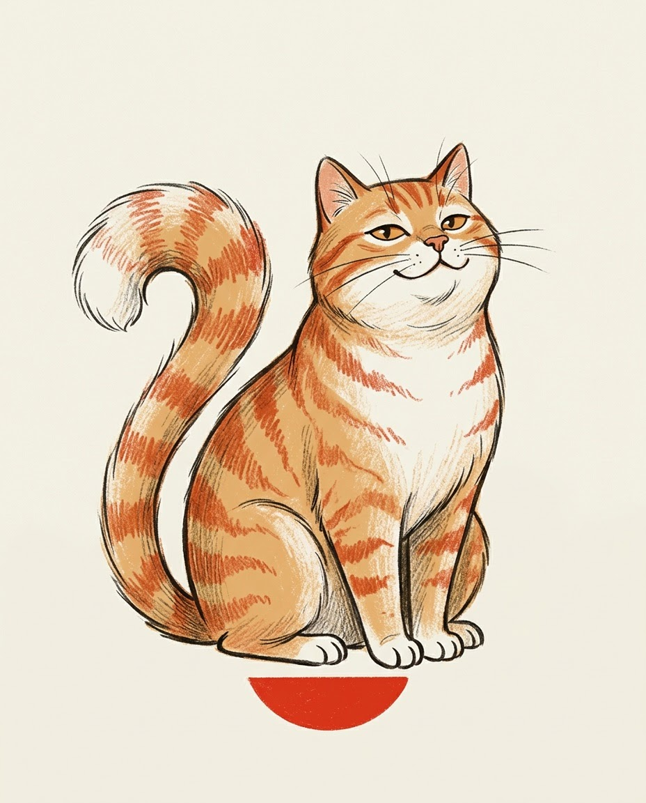 | **Тёплая книжная графика** — пушистый, домашний, «бабушкин». |
| 3 | 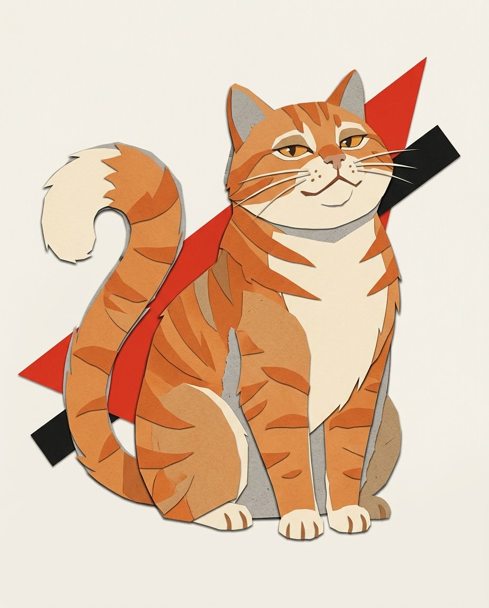 | **Вырезка-коллаж** — бумажный кот с хвостом-вопросом. Тот же стиль, что у Зили 3. |
| 4 | 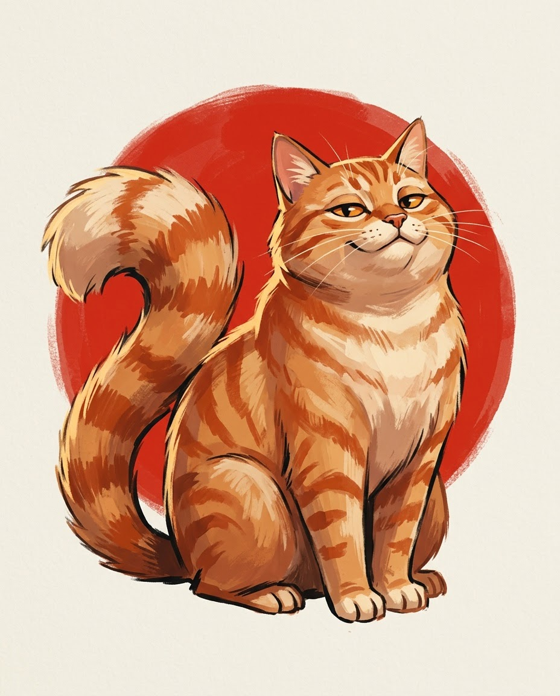 | **Гуашь** — самый вальяжный и «барский» по характеру. |

Отбраковано: в стиле 1 у второго кадра хвост растёт из бедра, в стиле 3 у второго кадра получилось два хвоста.

### Вместе (два самых сильных стиля)

| Стиль | Картинка | Что видно |
|---|---|---|
| Плакат | 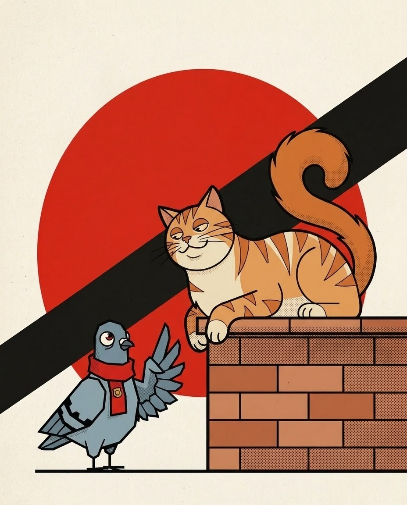 | Кот лениво лежит на кирпичной стенке, Зиля спорит снизу. Оба героя узнаваемы, хорошо видно разницу роста. |
| Коллаж | 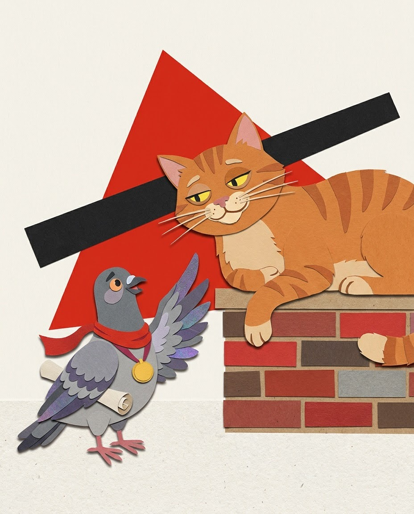 | Та же сцена из бумаги. У Зили потерялась гильза на лапе, вместо неё медаль и свиток: модель отошла от образа, при выборе этого стиля поправим. |

Пары сделаны на `fal-ai/nano-banana-pro/edit` от выбранных черновиков.

### Голоса

Модель — `elevenlabs/tts/eleven-v4` (на ней уже утверждён голос Зили, Callum), один-два варианта — `fal-ai/minimax/speech-2.8-hd` для сравнения. Файлы сырые, громкость не выровнена. Слова проверены распознаванием речи (`fal-ai/whisper`).

**Тюфель** — реплика под перголой: «Клад. Бабушка сказывала: Лиза что-то берегла, а в письме сказано где. Интерес чисто материальный. Мы, коты, существа простые.»

| Вариант | Файл | Тембр | Длительность |
|---|---|---|---|
| A | [tyufel-a-brian.mp3](voices/tyufel-a-brian.mp3) | бархатный, ленивый (голос Brian, `[lazily, drawling]`) | 11,0 с |
| B | [tyufel-b-bill.mp3](voices/tyufel-b-bill.mp3) | хрипловатый, ироничный (голос Bill, `[sarcastic, raspy]`) | 10,6 с |
| C | [tyufel-c-liam.mp3](voices/tyufel-c-liam.mp3) | молодой, быстрый (голос Liam, `[quick, cheeky]`) | 9,0 с |

Отбраковано: вариант MiniMax (Casual_Guy) сказал «сказала» вместо «сказывала» и растянул фразу до 14 с.

**Лёва** (оформитель, показание 1957 года): «Гляжу на ваших свидетелей. Оба честные. И оба при пуске ещё не родились. А я был — на стремянке, с кистью.»

| Вариант | Файл | Тембр | Длительность |
|---|---|---|---|
| A | [lyova-a-george.mp3](voices/lyova-a-george.mp3) | деловитый, бодрый (ElevenLabs, голос George) | 8,3 с |
| B | [lyova-b-minimax.mp3](voices/lyova-b-minimax.mp3) | твёрдый, энергичный (MiniMax, Determined_Man) | 7,8 с |

**Гоша** (испытатель, 1975): «Синяя птица? Моя, сам водил. Ей что берег, что вода: съехала — и пошла.»

| Вариант | Файл | Тембр | Длительность |
|---|---|---|---|
| A | [gosha-a-roger.mp3](voices/gosha-a-roger.mp3) | спокойный, немногословный (ElevenLabs, голос Roger) | 6,8 с |

Отбраковано: вариант MiniMax (Patient_Man) произнёс «Сынья птица» и потерял вопросительную интонацию.

Лизу не озвучивали: в сценарии v5 у неё нет реплик, только письмо.

### Рекомендация

- **Зиля 1 + Тюфель 1 (плакат).** Это самый «авангардный» вариант, он совпадает с брендом ЗИЛАРТа (красное, чёрное, бумага, диагонали), читается на экране телефона и продолжает уже сделанные портрет и видео Зили. Плоские формы проще всего оживлять в Kling и держать одинаковыми от кадра к кадру. Запасной вариант — коллаж (3 + 3): он самый своеобразный, но сложнее в анимации.
- **Голос кота — A (Brian).** По характеру Тюфель «вальяжный, обидчивый», и низкий ленивый тембр лучше всего отличается от лёгкого быстрого Зили. B — если хочется больше иронии. Рекомендация сделана по описанию героя и проверке текста: тембр нужно послушать.
- **Лёва — A (George), Гоша — A (Roger):** обе записи на той же модели, что и Зиля, без ошибок в словах.

**Ваш выбор.** Ответ: «Зиля 2, Тюфель 3, голос кота B» (если нужно, добавьте Лёву и Гошу: «Лёва A, Гоша A»). Без ответа продолжим с рекомендованными: Зиля 1, Тюфель 1, кот A, Лёва A, Гоша A.

Что будет после выбора: финальные листы персонажей на `nano-banana-pro` с правкой через `/edit`, затем сохранение героев в fal Assets как персонажей, чтобы они выглядели одинаково во всех сценах.

**В fal:** все варианты кастинга (картинки и голоса) — в fal Assets, коллекция «ЗИЛАРТ — кастинг героев (A-65)» (id `dc3qu2sregj2mdo1pq3g`), раздел Collections. Персонажами (Characters) станут выбранные по A-65.
