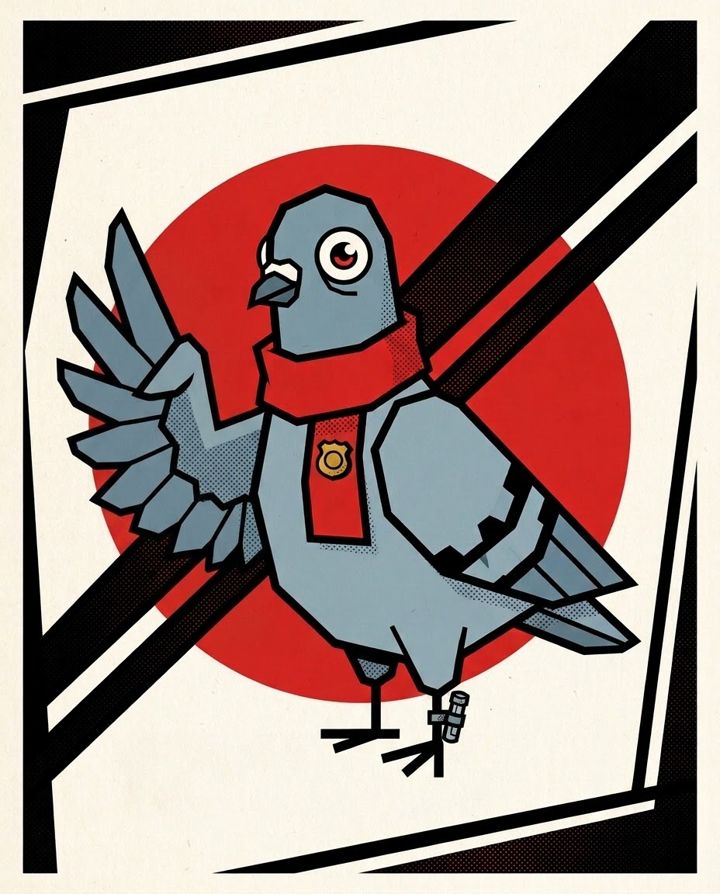
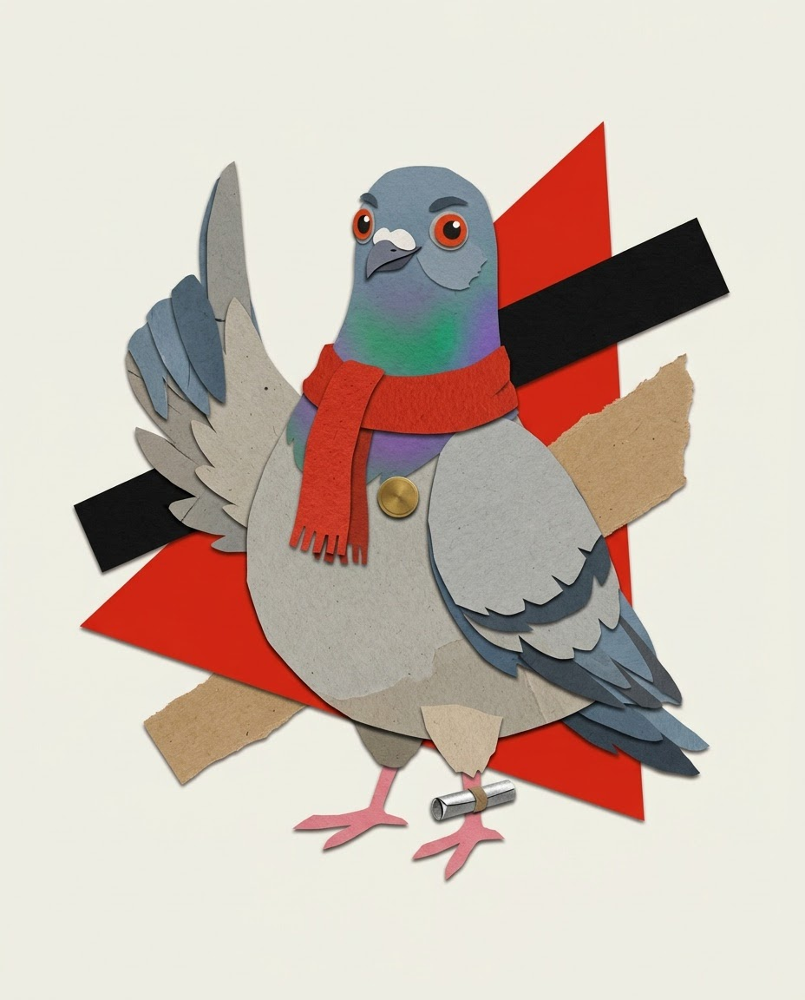
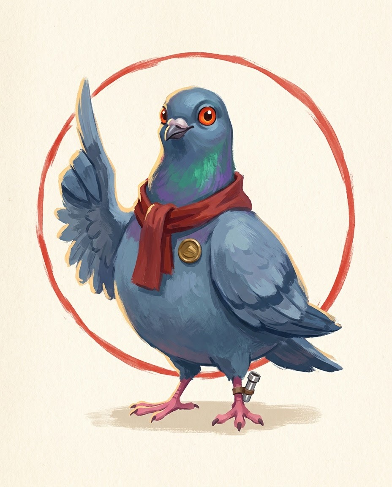

# Кастинг ЗИЛАРТа: как выглядят Зиля и Тюфель, как звучат герои

Раунд по указанию владельца от 26.11 (A-60). Потрачено **≈ $1,69 из $5** (подробно по строкам — `state/MEDIA_SPEND.md`). Все картинки — черновики (`fal-ai/nano-banana-2`, 1K): выбираем направление, финал нарисуем дорогой моделью от выбранного черновика (`/edit`, чтобы герой не «поплыл»). Промпты — `../specs/02-casting.md`.

Все четыре стиля сделаны одинаково: формат 4:5, кремовая «бумага», один красный знак фона, без текста. Черты героя одни и те же: у Зили сизое оперение, красный шарф, значок, гильза для письма на лапе; у Тюфеля — толстый рыжий полосатый кот, хвост вопросом, полуприкрытые глаза.

## Зиля

| № | Картинка | Стиль и чем хорош для квеста |
|---|---|---|
| 1 |  | **Плакат 1920-х** — развитие прежнего портрета: та же голова и шарф, вместо лупы значок и гильза. Самый «авангардный», читается в мелком размере, уже есть видео с этим Зилей. |
| 2 |  | **Тёплая книжная графика** — карандаш и литография, мягкий и добрый. Подходит семьям с детьми, но меньше связан с конструктивизмом ЗИЛа. |
| 3 |  | **Вырезка-коллаж** — герой сложен из рваной бумаги. Самый необычный и «рукотворный», хорошо ложится на тему писем и архива. |
| 4 |  | **Гуашь** — живописный, объёмный, самый «дорогой» на вид; хуже читается мелко и сложнее держать одинаковым от кадра к кадру. |

Отбраковано (на каждый стиль делали по 2 кадра, сюда взят лучший): в стилях 1 и 4 у второго кадра крыло нарисовано как кисть руки с пальцем. У Зили 2 кончик крыла тоже слегка похож на пальцы — в финале это поправим через `/edit`.

## Тюфель

| № | Картинка | Стиль и чем хорош для квеста |
|---|---|---|
| 1 |  | **Плакат 1920-х** — геометрия, чёткий контур, ироничная улыбка. В паре с Зилей 1 даёт единый мир. |
| 2 |  | **Тёплая книжная графика** — пушистый, домашний, «бабушкин». |
| 3 |  | **Вырезка-коллаж** — бумажный кот с хвостом-вопросом. Тот же стиль, что у Зили 3. |
| 4 |  | **Гуашь** — самый вальяжный и «барский» по характеру. |

Отбраковано: в стиле 1 у второго кадра хвост растёт из бедра, в стиле 3 у второго кадра получилось два хвоста.

## Вместе (два самых сильных стиля)

| Стиль | Картинка | Что видно |
|---|---|---|
| Плакат |  | Кот лениво лежит на кирпичной стенке, Зиля спорит снизу. Оба героя узнаваемы, хорошо видно разницу роста. |
| Коллаж |  | Та же сцена из бумаги. У Зили потерялась гильза на лапе, вместо неё медаль и свиток: модель отошла от образа, при выборе этого стиля поправим. |

Пары сделаны на `fal-ai/nano-banana-pro/edit` от выбранных черновиков.

## Голоса

Модель — `elevenlabs/tts/eleven-v4` (на ней уже утверждён голос Зили, Callum), один-два варианта — `fal-ai/minimax/speech-2.8-hd` для сравнения. Файлы сырые, громкость не выровнена. Слова проверены распознаванием речи (`fal-ai/whisper`).

**Тюфель** — реплика под перголой: «Клад. Бабушка сказывала: Лиза что-то берегла, а в письме сказано где. Интерес чисто материальный. Мы, коты, существа простые.»

| Вариант | Файл | Тембр | Длительность |
|---|---|---|---|
| A | [tyufel-a-brian.mp3](voices/tyufel-a-brian.mp3) | бархатный, ленивый (голос Brian, `[lazily, drawling]`) | 11,0 с |
| B | [tyufel-b-bill.mp3](voices/tyufel-b-bill.mp3) | хрипловатый, ироничный (голос Bill, `[sarcastic, raspy]`) | 10,6 с |
| C | [tyufel-c-liam.mp3](voices/tyufel-c-liam.mp3) | молодой, быстрый (голос Liam, `[quick, cheeky]`) | 9,0 с |

Отбраковано: вариант MiniMax (Casual_Guy) сказал «сказала» вместо «сказывала» и растянул фразу до 14 с.

**Лёва** (оформитель, показание 1957 года): «Гляжу на ваших свидетелей. Оба честные. И оба при пуске ещё не родились. А я был — на стремянке, с кистью.»

| Вариант | Файл | Тембр | Длительность |
|---|---|---|---|
| A | [lyova-a-george.mp3](voices/lyova-a-george.mp3) | деловитый, бодрый (ElevenLabs, голос George) | 8,3 с |
| B | [lyova-b-minimax.mp3](voices/lyova-b-minimax.mp3) | твёрдый, энергичный (MiniMax, Determined_Man) | 7,8 с |

**Гоша** (испытатель, 1975): «Синяя птица? Моя, сам водил. Ей что берег, что вода: съехала — и пошла.»

| Вариант | Файл | Тембр | Длительность |
|---|---|---|---|
| A | [gosha-a-roger.mp3](voices/gosha-a-roger.mp3) | спокойный, немногословный (ElevenLabs, голос Roger) | 6,8 с |

Отбраковано: вариант MiniMax (Patient_Man) произнёс «Сынья птица» и потерял вопросительную интонацию.

Лизу не озвучивали: в сценарии v5 у неё нет реплик, только письмо.

## Рекомендация

- **Зиля 1 + Тюфель 1 (плакат).** Это самый «авангардный» вариант, он совпадает с брендом ЗИЛАРТа (красное, чёрное, бумага, диагонали), читается на экране телефона и продолжает уже сделанные портрет и видео Зили. Плоские формы проще всего оживлять в Kling и держать одинаковыми от кадра к кадру. Запасной вариант — коллаж (3 + 3): он самый своеобразный, но сложнее в анимации.
- **Голос кота — A (Brian).** По характеру Тюфель «вальяжный, обидчивый», и низкий ленивый тембр лучше всего отличается от лёгкого быстрого Зили. B — если хочется больше иронии. Рекомендация сделана по описанию героя и проверке текста: тембр нужно послушать.
- **Лёва — A (George), Гоша — A (Roger):** обе записи на той же модели, что и Зиля, без ошибок в словах.

**Ваш выбор.** Ответ: «Зиля 2, Тюфель 3, голос кота B» (если нужно, добавьте Лёву и Гошу: «Лёва A, Гоша A»). Без ответа продолжим с рекомендованными: Зиля 1, Тюфель 1, кот A, Лёва A, Гоша A.

Что будет после выбора: финальные листы персонажей на `nano-banana-pro` с правкой через `/edit`, затем сохранение героев в fal Assets как персонажей, чтобы они выглядели одинаково во всех сценах.

**В fal:** все варианты кастинга (картинки и голоса) — в fal Assets, коллекция «ЗИЛАРТ — кастинг героев (A-65)» (id `dc3qu2sregj2mdo1pq3g`), раздел Collections. Персонажами (Characters) станут выбранные по A-65.
