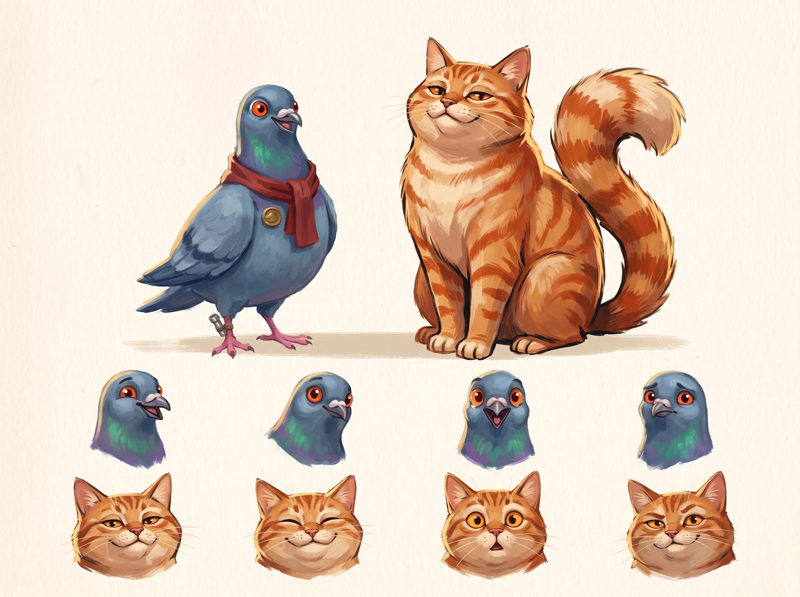

# Сцены ЗИЛАРТа в стиле 4 (гуашь): лист героев и 7 кадров

Основание: A-66 (27.11) — стиль 4 утверждён, потолок $7. Потрачено **$2,55** (17 генераций, по строкам — `state/MEDIA_SPEND.md`).
Модель всех кадров — `fal-ai/nano-banana-pro/edit`, 2K (1792×2400), 3:4, JPEG. Text-to-image не использовался: всё рисуется от листа героев.

## Лист героев — эталон для всех следующих кадров



- Файл: `ref-sheet-4.jpg` (1600 px; оригинал 2400×1792 — fal Assets, `assetRecordId dc4g6tsregj0ilpg3re0`, request `01a21b2e-0329-72e2-9496-ca87fb038058`, seed 2711).
- Референсы: `casting/zilya-4-gouache.jpg`, `casting/tyufel-4-gouache.jpg`, `casting/round2-scene-meet-4.jpg` (соотношение роста).
- Что зафиксировано: стоящий Зиля ≈ 0,6 высоты сидящего Тюфеля (глаз голубя на уровне подбородка кота); голова Зили ≈ 0,55–0,6 головы кота; у Зили шарф, значок на груди, гильза на правой лапе, крылья без «пальцев»; у Тюфеля кремовая грудь, хвост вопросом, на нём ничего не надето. Восемь выражений — все дружелюбные.
- Число для головы на листе (≈ 0,6) меньше, чем в каноне `specs/02-casting.md` (0,8–0,9): на листе герои выглядят естественнее. Канон стоит поправить под лист — вопрос владельцу.

## Кадры

Файл для плеера — `site/play/zilart/media/scenes/<имя>.jpg` (810×1080, ≤ 165 КБ). Исходник 2K для анимации — в fal Assets, коллекция `dc3qu2sregj2mdo1pq3g`; полный текст промпта любого шага — рецепт по `request_id`.

| Кадр | Где в квесте | Исходник 2K (request_id · assetRecordId) | seed | Как получен |
|---|---|---|---|---|
| `s01-kurlyk` | точка 1, сцена: «Курлык! Вы по делу?» | `01a21b2f-b259-7f11-a04e-a0d74fbc5ecf` · `dc4g6u4regjfjkhg3sag` | 2701 | от листа, 1 проход; бумажное поле обрезано |
| `s02-amo-1931` | вступление: голубь Амо несёт письмо над заводом | `01a21b2f-b2ae-7a62-943b-520ce6c4f70a` · `dc4g6ukregjfjkhg3t7g` | 2702 | от листа (стиль и сложение голубя), 1 проход; поле обрезано |
| `s03-bench` | точка 3, сцена: встреча с Тюфелем | `01a21b2f-b2af-7d20-b096-58e71af0a89d` · `dc4g6usregjftvpg3tsg` | 2703 | от листа, 1 проход; поле обрезано |
| `s04-strip` | точка 6, шаг 1: полоска на просвет | `01a21b34-c047-7420-b4ac-a3695af0e2d4` · `dc4g6vcregj0ilpg3uh0` | 2744 | лист + `s03` → `01a21b31-3e49…` (2714) → без поля `01a21b33-f05d…` (2734) → голубь ×1,3 |
| `s05-badge` | точка 8, шаг 5: Тюфель возвращает значок | `01a21b33-1361-7393-97c2-ba9146acb5b8` · `dc4g6vkregj0m3pg3uu0` | 2735 | лист + `s03` → `01a21b31-3e4b…` (2715) → голубь ×1,4 `01a21b32-6121…` (2725) → отъезд на 12% |
| `s06-tree` | точка 10, после протокола: отдых под деревом | `01a21b32-611f-79b0-bf67-0245e5f47fc0` · `dc4g6vsregjfjkhg3vag` | 2726 | лист + `s03` → `01a21b31-3e8b…` (2716) → голубь ×1,4 |
| `s07-flight` | эпилог: Зиля несёт Тюфеля над крышами | `01a21b31-3e85-7f83-a6a8-b6dea26c36e5` · `dc4g70cregj0ilpg40bg` | 2717 | правка `casting/round2-scene-fly-4.jpg` + лист: новые лица, 3:4, без красного мазка |

Брак первого прохода (не сохранён): `s04`–`s07` от одного листа — стиль уплыл в плоский мультфильм, кот худой, шарф и значок оказались на коте (requests `01a21b2f-b2a8…`, `-b2ab…`, `-b2a6…`, `-b2aa…`). Вылечилось вторым референсом — принятой сценой `s03`.

## Промпты

Общий каркас двухгеройной сцены (менялись блоки SCENE и BACKGROUND):

```
Image 1 is the approved character reference sheet; image 2 is an approved finished scene with the same two characters. Paint ONE new scene in exactly the same gouache painting style, character designs and relative sizes as image 2 (do not copy its bench or composition; do not reproduce the sheet layout).
Tyufel is the same huge, fat, lordly ADULT ginger tabby cat as in image 2: massive round body and belly, wide cheeks, half-closed amber eyes, striped question-mark tail. He wears NOTHING: no scarf, no collar, no badge. Zilya is the same plump blue-grey pigeon: ONLY Zilya wears the red scarf, the round brass badge on his chest and the tiny metal tube on his leg.
SIZE CANON: the cat is much bigger and heavier than the pigeon; Zilya's whole body is 0.6-0.7 of Tyufel's body length (tail excluded), Zilya's head is slightly smaller than Tyufel's head.

SCENE: <кто где, поза, выражение каждого; «Exactly two characters; cat: four paws, one tail; pigeon: two wings (no hands), two legs»>
BACKGROUND: very simple, in large soft shapes: <2–3 крупных пятна>. No small details, no signs, no other figures, no recognisable landmarks.
COMPOSITION for later animation: vertical 3:4; the painting fills the entire canvas edge to edge with NO paper border, no white margin, no vignette; both characters fully inside the frame with generous free space around them, tail not cropped.
No text, no letters, no numbers, no logos, no watermark.
```

Блоки SCENE:
- **s01** — Zilya alone, full body, standing on a low stone kerb at the edge of an autumn city park, greeting the viewer like a cheerful little detective who is glad you came; happy, proud, welcoming expression, beak slightly open in a smile; chest puffed out so the brass badge catches the light; one wing lifted a little in a friendly wave (a real feathered wing, never a hand), the other folded.
- **s02** — autumn 1931: a carrier pigeon named Amo, the great-great-grandfather of the pigeon on the sheet: same plump blue-grey body, green-violet neck sheen, round orange-red eyes, but NO scarf and NO badge, a tiny metal message tube on one leg. He flies from left to right in an easy, confident glide, bright, calm, purposeful. Far below: long factory workshops with sawtooth roofs, two tall brick chimneys with thin smoke, a hint of a river, pale dawn sky; muted old-photograph palette, one tiny plain red flag.
- **s03** — first meeting: Tyufel lounges on a wooden park bench like a lord on a sofa, one front paw on his round belly, chin raised, half-closed eyes, calm and dignified with a faint good-natured, slightly sly look. Zilya stands on the armrest, wings folded, leaning toward the cat with a curious, friendly, lively expression.
- **s04** — Zilya stands on a low round stone bollard and holds a long narrow strip of old yellowed paper in his beak; low sun shines through it from behind. Big fat Tyufel sits right next to the bollard and peers up at the strip with one eye narrowed like an expert, a pleased knowing smile, one front paw raised. The strip is completely blank: no writing, no lines, no marks.
- **s05** — river embankment at early dusk: Zilya's brass badge is not on his chest; it lies on the paving between the friends. Tyufel gently pushes it back toward the pigeon with one front paw, with a genuinely warm, kind, encouraging smile. Zilya looks up at him with wide, surprised, hopeful eyes and the beginning of a smile. Tender and hopeful: no tears, no drooping, no frowning.
- **s06** — an old tree whose trunk divides at the ground into two trunks in a narrow V. Tyufel lies on the grass at its foot, paws tucked, eyes closed in a blissful smile. Zilya perches on a low branch directly above, looking down with a happy, proud, peaceful smile.
- **s07** (правка кадра) — keep style, city, body poses, wings, the cat's size; change the faces so that the flight looks light, easy and joyful instead of strained: Zilya — no frown, no worried eyebrows, no gritted beak; happy proud face, beak open in a cheerful laugh, eyes sparkling. Tyufel — big delighted smile, eyes bright with wonder, front paws spread like wings. Remove the red brushstroke and the red tower; 3:4, no border.

Правка размера (s04–s06): `Edit image 1. Keep everything exactly as it is … Change ONLY the pigeon: he is too small. Redraw the same pigeon about 1.4 times bigger … the pigeon's head must be a little more than half the size of the cat's head … exactly like the two full-body figures on the reference sheet in image 2.` Работает с первого раза, остальное в кадре не меняется.

## Под анимацию (image-to-video)

- Один кадр — одна поза; фон из крупных пятен, без мелкого шума; герои целиком в кадре. Исходник — 2K из fal Assets (в плеере лежит уменьшенная копия).
- Тесные места: в `s01` кончик правого крыла, в `s02` кончик левого крыла и в `s05` хвост Зили подходят к краю вплотную — для ролика с движением в ту сторону сначала расширить кадр (`/edit`: «zoom out 12%, extend the scene»), это $0,15.
- Модель и цена — `docs/fal-guide.md` (Kling 2.5 turbo pro, $0,35 за 5 с). Что двигать: `s01` — взмах крыла, моргание; `s02` — крылья, дым, флажок; `s03` — хвост кота, наклон головы Зили; `s04` — полоска качается, свет мерцает; `s05` — лапа двигает значок, блики на воде; `s06` — листья падают, кот дышит; `s07` — крылья, шарф, город уходит назад.
- Negative для всех: `morphing, extra limbs, extra tail, extra wings, hands, text, change of character size`.

## Что проверено глазами

Анатомия (два крыла, две лапы у Зили; четыре лапы и один хвост у Тюфеля), нет букв и подписей, нет ответов загадок: полоска пустая, значок без надписи, дерево с двумя стволами показано только после ответа. Выражения — дружелюбные во всех кадрах. Реальные объекты (пергола, медный дом, набережная с её оградой) не рисовались: фон условный, по правилу от 24.11.
